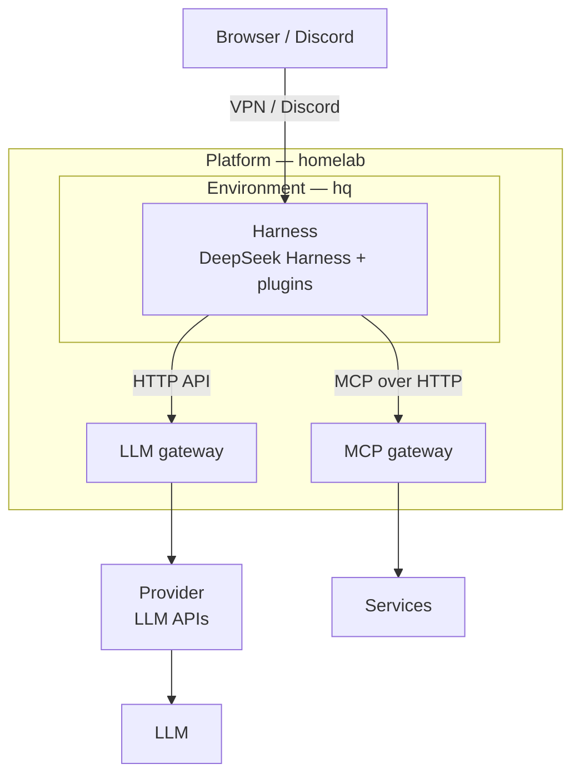

[日本語](https://github.com/shin-sakata) | English

# shin-sakata

Software engineer and Scrum Master in Tokyo, specializing in the web and AI agents.\
At HERP, I designed and built [AI Recruiter](https://lp.herp.cloud/ai-recruiter), a recruiting AI agent.\
Now I work freelance, and run [langify.org](https://github.com/langify-org), my personal project.

Contact: [X](https://x.com/lambda_funtaro) / [YOUTRUST](https://youtrust.jp/users/shin-sakata)

## [langify.org](https://github.com/langify-org)

Like Muse, dot, Claude Duet, and Grok Bot, AI agents are moving onto computers of their own, running around the clock.\
langify.org researches and builds what it takes to self-host them, and open-sources it.\
Parts of it are already public.

- **Always-on**\
  Close your laptop, and your agent stops.\
  Here, agents run around the clock on a dedicated machine, keeping their conversations and state.
- **Anywhere**\
  Talk to the same agent and hand it work from any device.
- **Replaceable**\
  Models, tool protocols, and harnesses turn over every few months.\
  The platform is split into layers joined by standard protocols, so each can be swapped on its own.
- **Secure by design**\
  The way in to the agents stays inside a VPN, never on the internet.\
  The host runs IncusOS: immutable, and self-updating.\
  Credentials live in 1Password, and agents reach only what they need.\
  Running always-on agents safely is itself part of the research.

- **Platform**: homelab — Instances on IncusOS, defined with OpenTofu
- **Environment**: hq — The NixOS VM where the harness lives
- **Harness extensions**: [deepseek-harness-plugins](https://github.com/langify-org/deepseek-harness-plugins) — Discord, code-server, conversation forks

## Career

- **[langify.org](https://github.com/langify-org)** (personal project)\
  Research, development, and open-sourcing of a platform for always-on AI agents
- **[Spir](https://www.spirinc.com/)** (2026.01–, freelance)\
  Scheduling SaaS
- **[BrainPad](https://www.brainpad.co.jp/)** (2025.07–2025.10, freelance)\
  Technical support for AI agents and multimodal RAG
- **[HERP](https://herp.co.jp/)** (2020.09–2026.01)\
  Designed and built AI Recruiter, a recruiting AI agent, on the Vercel AI SDK.\
  Users just talk to it; the agent pulls what it needs from the ATS through tool calls.\
  Also built [DataHub](https://lp.herp.cloud/datahub), and led company-wide LeSS adoption as a Scrum Master.
- **[Leverages](https://leverages.jp/)** (2019.02–2020.08)\
  Tech lead for [Hataractive](https://hataractive.jp/)

## Other

- **[Citrous](https://github.com/shin-sakata/Citrous)**\
  A type-safe web framework for Haskell, with a type-level routing DSL
