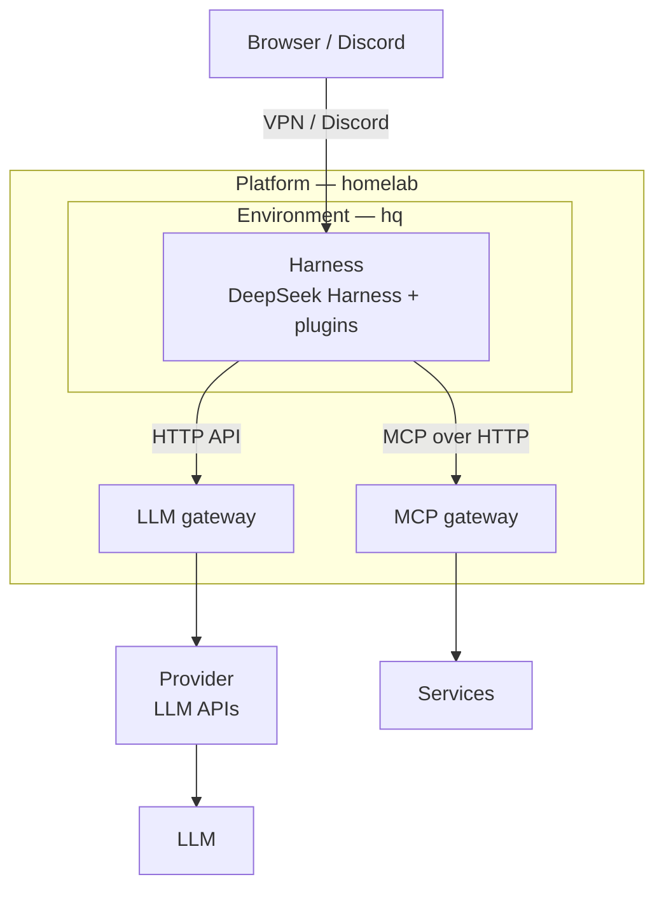

[日本語](https://github.com/shin-sakata) | English

# shin-sakata

Software engineer in Tokyo, specializing in AI agents.
At HERP, I designed and built [AI Recruiter](https://lp.herp.cloud/ai-recruiter), a recruiting AI agent. Now I work freelance, and at [langify.org](https://github.com/langify-org), my personal project, I research and build a platform for always-on AI agents and open-source it.

Contact: [X](https://x.com/lambda_funtaro) / [YOUTRUST](https://youtrust.jp/users/shin-sakata)

## [langify.org](https://github.com/langify-org)

As Muse, dot, Claude Duet, and Grok Bot show, AI agents are becoming something that runs around the clock on a computer of its own, and that you can talk to from anywhere. langify.org is a personal project that researches and builds the platform for such agents on infrastructure you own, and open-sources the results. Parts of it are already public.

- **Always-on** — Close your laptop, and your agent stops. Here, agents get a dedicated machine and run around the clock; their conversations and work survive even rebuilding that machine.
- **Anywhere** — Talk to the same agent and hand it work from any device: a browser, a chat app.
- **Replaceable** — Models, tool protocols, and harnesses turn over every few months. The platform is split into layers joined by standard protocols, so each layer can be swapped on its own.
- **Secure by design** — Running agents around the clock on your own hardware makes security a premise, not an add-on. The way in to the agents never faces the internet; it stays inside a VPN. The host runs IncusOS, an immutable, API-only OS that keeps itself updated. Credentials are kept in 1Password, and agents can reach only what they need. How to run always-on agents safely is itself part of the research.

- **Platform**: homelab — Instances on IncusOS, defined with OpenTofu
- **Environment**: hq — The NixOS VM where the harness lives, and the harness's configuration
- **Harness extensions**: [deepseek-harness-plugins](https://github.com/langify-org/deepseek-harness-plugins) — Drive a session from Discord, edit files in code-server, ask a side question in a fork of the conversation

## Career

- **[langify.org](https://github.com/langify-org)** (personal project): Research, development, and open-sourcing of a platform for always-on AI agents
- **[Spir](https://www.spirinc.com/)** (2026.01–, freelance): Scheduling SaaS
- **[BrainPad](https://www.brainpad.co.jp/)** (2025.07–2025.10, freelance): Technical support for AI agents and multimodal RAG
- **[HERP](https://herp.co.jp/)** (2020.09–2026.01): Designed and built AI Recruiter, a recruiting AI agent, on the Vercel AI SDK. Users simply talk to it; the agent pulls what it needs from the ATS through tool calls. Also built [DataHub](https://lp.herp.cloud/datahub), a recruiting analytics tool, and led the company-wide adoption of LeSS as a Scrum Master.
- **[Leverages](https://leverages.jp/)** (2019.02–2020.08): Tech lead for [Hataractive](https://hataractive.jp/)

## Other

- **[Citrous](https://github.com/shin-sakata/Citrous)**: A type-safe web framework for Haskell, with a type-level routing DSL
