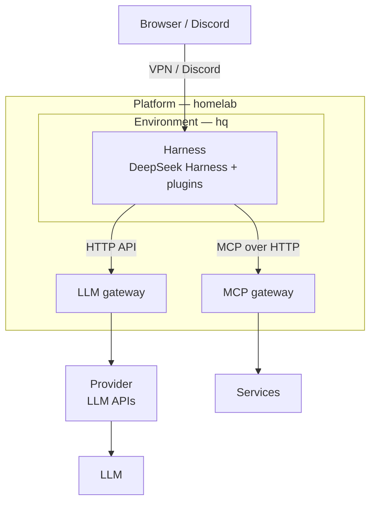

日本語 | [English](https://github.com/shin-sakata/shin-sakata/blob/main/README.en.md)

# shin-sakata

東京を拠点とするソフトウェアエンジニア、スクラムマスター。専門は Web と AI エージェント。\
HERP では、採用 AI エージェント [AI Recruiter](https://lp.herp.cloud/ai-recruiter) を設計・実装した。\
現在は業務委託で開発に携わりつつ、個人プロジェクト [langify.org](https://github.com/langify-org) を進めている。

連絡先：[X](https://x.com/lambda_funtaro) / [YOUTRUST](https://youtrust.jp/users/shin-sakata)

## [langify.org](https://github.com/langify-org)

Muse、dot、Claude Duet、Grok Bot のように、AI エージェントは専用の計算機で常時稼働する存在になりつつある。\
langify.org は、その実行基盤を自前のインフラで研究開発し、OSS として公開していく。\
一部はすでに公開している。

- **Always-on**\
  ノート PC を閉じれば、エージェントも止まる。\
  専用の計算機で常時稼働させ、会話と状態を保ち続ける。
- **Anywhere**\
  どの端末からでも、同じエージェントに話しかけ、仕事を任せられる。
- **Replaceable**\
  モデルも、ツールの接続方式も、ハーネスも、数か月で入れ替わる。\
  基盤を層に分けて標準的なプロトコルでつなぎ、層ごとに置き換えられるようにする。
- **Secure by design**\
  エージェントの入口はインターネットに出さず、VPN の内側に閉じる。\
  ホスト OS は、不変で自動更新される IncusOS。\
  認証情報は 1Password に集約し、エージェントが触れる範囲を最小限に絞る。\
  常駐するエージェントを安全に運用する方法そのものも、研究の対象としている。

- **Platform**：homelab — IncusOS 上のインスタンスを OpenTofu で定義
- **Environment**：hq — ハーネスが常駐する NixOS の仮想マシン
- **Harness の拡張**：[deepseek-harness-plugins](https://github.com/langify-org/deepseek-harness-plugins) — Discord 連携、code-server、会話の分岐

## 経歴

- **[langify.org](https://github.com/langify-org)**（個人プロジェクト）\
  常駐型 AI エージェントの実行基盤の研究開発と OSS 化
- **[Spir](https://www.spirinc.com/)**（2026.01〜、業務委託）\
  日程調整 SaaS の開発
- **[BrainPad](https://www.brainpad.co.jp/)**（2025.07〜2025.10、業務委託）\
  AI エージェント・マルチモーダル RAG の技術支援
- **[HERP](https://herp.co.jp/)**（2020.09〜2026.01）\
  採用 AI エージェント AI Recruiter を Vercel AI SDK で設計・実装。\
  対話するだけで、エージェントがツールを使って ATS から情報を取得し、応答する。\
  ほかに採用データ集計ツール [DataHub](https://lp.herp.cloud/datahub) の開発、スクラムマスターとして LeSS の全社導入。
- **[Leverages](https://leverages.jp/)**（2019.02〜2020.08）\
  [ハタラクティブ](https://hataractive.jp/) のテックリード

## その他

- **[Citrous](https://github.com/shin-sakata/Citrous)**\
  型レベルのルーティング DSL を備えた、Haskell 向けの型安全な Web フレームワーク
