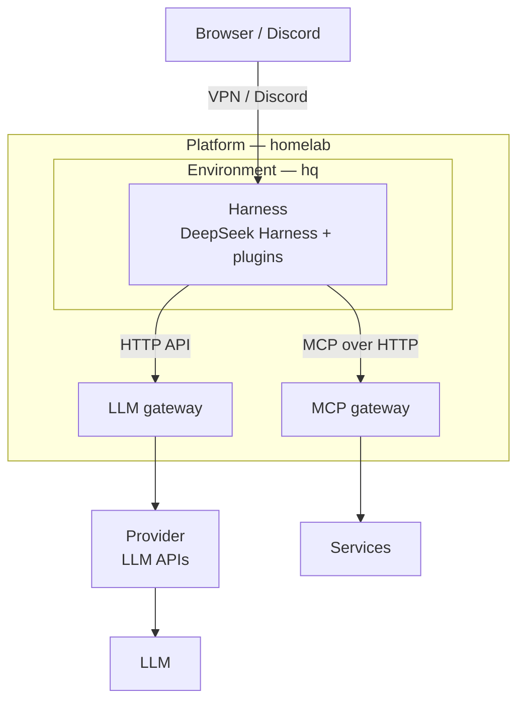

日本語 | [English](https://github.com/shin-sakata/shin-sakata/blob/main/README.en.md)

# shin-sakata

東京を拠点とする、AI エージェントを専門とするソフトウェアエンジニア。
HERP では採用 AI エージェント [AI Recruiter](https://lp.herp.cloud/ai-recruiter) を設計・実装した。現在は業務委託で開発に携わるかたわら、個人プロジェクト [langify.org](https://github.com/langify-org) で、常駐型 AI エージェントの実行基盤を研究開発し、OSS として公開している。

連絡先：[X](https://x.com/lambda_funtaro) / [YOUTRUST](https://youtrust.jp/users/shin-sakata)

## [langify.org](https://github.com/langify-org)

Muse、dot、Claude Duet、Grok Bot に見られるように、AI エージェントは専用の計算機で常時稼働し、どこからでも話しかけられる存在になりつつある。langify.org は、その実行基盤を自ら所有するインフラの上で研究開発し、成果を OSS として公開していく個人プロジェクトである。一部はすでに公開している。

- **Always-on** — ノート PC を閉じれば、エージェントも止まる。エージェントに専用の計算機を与えて常時稼働させ、会話と作業の状態は計算機を作り直しても失われないようにする。
- **Anywhere** — ブラウザやチャットなど、手元のどの端末からでも同じエージェントに話しかけ、仕事を任せられるようにする。
- **Replaceable** — モデルも、ツールの接続方式も、ハーネスも、数か月単位で入れ替わる。基盤を層に分け、層の間を標準的なプロトコルで接続することで、各層を独立に置き換えられるようにする。
- **Secure by design** — 自前のサーバーで常時稼働させる以上、安全性は設計の前提となる。エージェントへの入口はインターネットに公開せず、VPN の内側に閉じる。ホスト OS には API でのみ管理される不変の OS（IncusOS）を用い、自動で更新し続ける。認証情報は 1Password に集約し、エージェントが触れられる範囲を最小限に絞る。常駐するエージェントを安全に運用する方法そのものも、研究の対象としている。

- **Platform**：homelab — IncusOS 上のインスタンスを OpenTofu で定義する
- **Environment**：hq — ハーネスが常駐する NixOS の仮想マシンと、ハーネスの設定
- **Harness の拡張**：[deepseek-harness-plugins](https://github.com/langify-org/deepseek-harness-plugins) — Discord からのセッション操作、code-server によるファイル編集、会話の分岐による副次的な質問

## 経歴

- **[langify.org](https://github.com/langify-org)**（個人プロジェクト）：常駐型 AI エージェントの実行基盤の研究開発と OSS 化
- **[Spir](https://www.spirinc.com/)**（2026.01〜、業務委託）：日程調整 SaaS の開発
- **[BrainPad](https://www.brainpad.co.jp/)**（2025.07〜2025.10、業務委託）：AI エージェントおよびマルチモーダル RAG の技術支援
- **[HERP](https://herp.co.jp/)**（2020.09〜2026.01）：採用 AI エージェント AI Recruiter を Vercel AI SDK 上で設計・実装した。利用者は自然言語で対話するのみでよく、エージェントはツール呼び出しによって ATS から必要な情報を取得して応答する。ほかに採用データ集計ツール [DataHub](https://lp.herp.cloud/datahub) を開発し、スクラムマスターとして LeSS の全社導入を主導した。
- **[Leverages](https://leverages.jp/)**（2019.02〜2020.08）：[ハタラクティブ](https://hataractive.jp/) のテックリード

## その他

- **[Citrous](https://github.com/shin-sakata/Citrous)**：型レベルのルーティング DSL を備えた、Haskell 向けの型安全な Web フレームワーク
